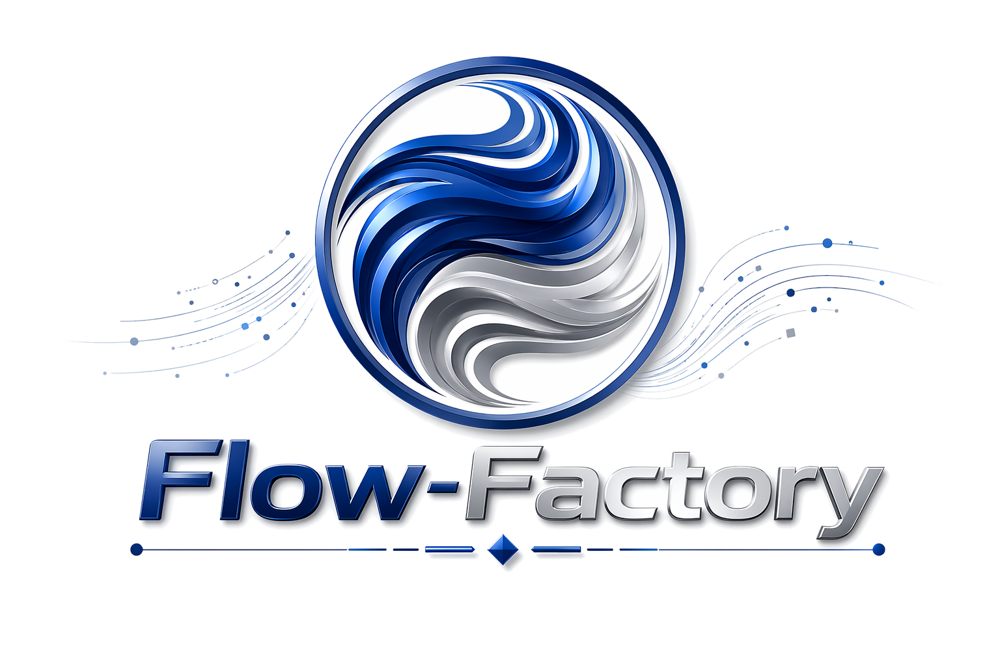

<p align="center">
  
</p>
<h1 align="center">Flow-Factory</h1>

<p align="center">
  <b>Unified Online RL and Offline Fine-Tuning for Diffusion and Flow-Matching Models</b>
</p>

# 🔥 News

* **[2026-10-17]** **Prompt enhancement** as a separate step! `ff-prompt-enhance` rewrites a
  dataset's prompts with a model's prompt enhancer (FLUX.3 pup, FLUX.2, LTX-2, the Qwen-Image-2.1
  T2I and I2I rewriters, or any OpenAI-compatible server) and writes a new dataset whose prompts
  training uses verbatim.
  See [Prompt Enhancement](docs/prompt_enhance.md).

* **[2026-10-16]** **FLUX.3 Image Klein** support! Train both the base (`black-forest-labs/flux-3-image-klein-base`)
  and step-distilled flow-map (`black-forest-labs/flux-3-image-klein`) text-to-image and multi-reference
  image-to-image models with the [GRPO + LoRA recipe](examples/grpo/lora/flux3/default.yaml).
  Requires the [pinned Diffusers submodule](#pinned-diffusers-for-flux3-and-qwen-image-21).

* **[2026-09-20]** **Qwen-Image 2.1** support! Train the unified text-to-image and
  ordered multi-image editing model with the [GRPO + LoRA recipe](examples/grpo/lora/qwen_image_2_1/default.yaml).
  Requires the [pinned Diffusers submodule](#pinned-diffusers-for-flux3-and-qwen-image-21).

* **[2026-08-21]** **MiniMax H3 Audio-Video** support! Fine-tune
  [text-to-audio-video](examples/grpo/lora/minimax_h3_t2va/debug.yaml),
  [first/last-frame-to-audio-video](examples/grpo/lora/minimax_h3_fl2va/default.yaml), and
  [ordered-reference-to-audio-video](examples/grpo/lora/minimax_h3_ref2va/default.yaml)
  workflows with GRPO + LoRA through the released Diffusers API.

* **[2026-04-25]** **LTX-2 Audio-Video** support! Generate synchronized audio-video content with RL
  fine-tuning through the released Diffusers API.

* **[2026-02-01]** Support for multiple **Attention Backends**! Select one in the unified
  `acceleration:` block, where it can be combined with `torch.compile` and feature caching:
```yaml
acceleration:
  shared:
    - name: attention_backend
      params: { backend: "flash_hub" } # e.g. "native", "xformers", "flash_hub", "_flash_3_hub", "_flash_3_varlen_hub"
```
  The name is forwarded to Diffusers' `transformer.set_attention_backend`; see the
  [official list](https://huggingface.co/docs/diffusers/main/en/optimization/attention_backends#available-backends)
  and the [Acceleration guide](docs/acceleration.md). We recommend installing `kernels`
  (`pip install kernels`) and using a `*_hub` backend instead of building Flash-Attention yourself.

# 📕 Table of Contents

- [Supported Models](#-supported-models)
- [Supported Algorithms](#-supported-algorithms)
- [Get Started](#-get-started)
  - [Installation](#installation)
  - [Experiment Trackers](#experiment-trackers)
  - [Quick Start Example](#quick-start-example)
- [Documentation](#-documentation)
- [Dataset](#-dataset)
  - [Offline SFT and Preference Data](#offline-sft-and-preference-data)
  - [Text-to-Image & Text-to-Video](#text-to-image--text-to-video)
  - [Image-to-Image & Image-to-Video](#image-to-image--image-to-video)
- [Reward Model](#-reward-model)
- [Acknowledgements](#-acknowledgements)
- [Citation](#-citation)

# 🤗 Supported Models

<table>
  <tr><th>Task</th><th>Model</th><th>Model Size</th><th>Model Type</th></tr>
  <tr><td rowspan="6">Text-to-Image</td><td><a href="https://huggingface.co/collections/stabilityai/stable-diffusion-35">stable-diffusion-3.5-medium/large</a></td><td>2.5B/8.1B</td><td>sd3-5</td></tr>
  <tr><td><a href="https://huggingface.co/black-forest-labs/FLUX.1-dev">FLUX.1-dev</a></td><td>13B</td><td>flux1</td></tr>
  <tr><td><a href="https://huggingface.co/Tongyi-MAI/Z-Image-Turbo">Z-Image-Turbo</a></td><td>6B</td><td>z-image</td></tr>
  <tr><td><a href="https://huggingface.co/Tongyi-MAI/Z-Image">Z-Image</a></td><td>6B</td><td>z-image</td></tr>
  <tr><td><a href="https://huggingface.co/Qwen/Qwen-Image">Qwen-Image</a></td><td>20B</td><td>qwen-image</td></tr>
  <tr><td><a href="https://huggingface.co/Qwen/Qwen-Image-2512">Qwen-Image-2512</a></td><td>20B</td><td>qwen-image</td></tr>
  <tr><td>Image-to-Image</td><td><a href="https://huggingface.co/black-forest-labs/FLUX.1-Kontext-dev">FLUX.1-Kontext-dev</a></td><td>13B</td><td>flux1-kontext</td></tr>

  <tr><td rowspan="2">Image(s)-to-Image</td><td><a href="https://huggingface.co/Qwen/Qwen-Image-Edit-2509">Qwen-Image-Edit-2509</a></td><td>20B</td><td>qwen-image-edit-plus</td></tr>
  <tr><td><a href="https://huggingface.co/Qwen/Qwen-Image-Edit-2511">Qwen-Image-Edit-2511</a></td><td>20B</td><td>qwen-image-edit-plus</td></tr>

  <tr><td rowspan="11">Text-to-Image & Image(s)-to-Image</td><td><a href="https://huggingface.co/black-forest-labs/FLUX.2-dev">FLUX.2-dev</a></td><td>32B</td><td>flux2</td></tr>
  <tr><td><a href="https://huggingface.co/black-forest-labs/FLUX.2-klein-4B">FLUX.2-klein-4B</a></td><td>4B</td><td>flux2-klein</td></tr>
  <tr><td><a href="https://huggingface.co/black-forest-labs/FLUX.2-klein-9B">FLUX.2-klein-9B</a></td><td>9B</td><td>flux2-klein</td></tr>
  <tr><td><a href="https://huggingface.co/black-forest-labs/FLUX.2-klein-base-4B">FLUX.2-klein-base-4B</a></td><td>4B</td><td>flux2-klein</td></tr>
  <tr><td><a href="https://huggingface.co/black-forest-labs/FLUX.2-klein-base-9B">FLUX.2-klein-base-9B</a></td><td>9B</td><td>flux2-klein</td></tr>
  <tr><td><a href="https://huggingface.co/black-forest-labs/flux-3-image-klein-base">flux-3-image-klein-base</a></td><td>5.5B</td><td>flux3</td></tr>
  <tr><td><a href="https://huggingface.co/black-forest-labs/flux-3-image-klein">flux-3-image-klein</a></td><td>5.5B</td><td>flux3</td></tr>
  <tr><td><a href="https://huggingface.co/ByteDance-Seed/BAGEL-7B-MoT">BAGEL-7B-MoT</a></td><td>14B</td><td>bagel</td></tr>
  <tr><td><a href="https://huggingface.co/sensenova/SenseNova-U1-8B-MoT">SenseNova-U1 1.0</a></td><td>16B</td><td>sensenova</td></tr>
  <tr><td><a href="https://huggingface.co/sensenova/SenseNova-U1.5-8B-MoT">SenseNova-U1 1.5</a></td><td>16B</td><td>sensenova</td></tr>
  <tr><td><a href="https://huggingface.co/Qwen/Qwen-Image-2.1">Qwen-Image 2.1</a></td><td>7B</td><td>qwen-image-2.1</td></tr>

  <tr><td rowspan="4">Text-to-Video</td><td><a href="https://huggingface.co/Wan-AI/Wan2.1-T2V-1.3B-Diffusers">Wan2.1-T2V-1.3B</a></td><td>1.3B</td><td>wan2_t2v</td></tr>
  <tr><td><a href="https://huggingface.co/Wan-AI/Wan2.1-T2V-14B-Diffusers">Wan2.1-T2V-14B</a></td><td>14B</td><td>wan2_t2v</td></tr>
  <tr><td><a href="https://huggingface.co/Wan-AI/Wan2.2-TI2V-5B-Diffusers">Wan2.2-TI2V-5B</a></td><td>5B</td><td>wan2_t2v</td></tr>
  <tr><td><a href="https://huggingface.co/Wan-AI/Wan2.2-T2V-A14B-Diffusers">Wan2.2-T2V-A14B</a></td><td>A14B</td><td>wan2_t2v</td></tr>

  <tr><td rowspan="4">Image-to-Video</td><td><a href="https://huggingface.co/Wan-AI/Wan2.1-I2V-14B-480P-Diffusers">Wan2.1-I2V-14B-480P</a></td><td>14B</td><td>wan2_i2v</td></tr>
  <tr><td><a href="https://huggingface.co/Wan-AI/Wan2.1-I2V-14B-720P-Diffusers">Wan2.1-I2V-14B-720P</a></td><td>14B</td><td>wan2_i2v</td></tr>
  <tr><td><a href="https://huggingface.co/Wan-AI/Wan2.2-TI2V-5B-Diffusers">Wan2.2-TI2V-5B</a></td><td>5B</td><td>wan2_i2v</td></tr>
  <tr><td><a href="https://huggingface.co/Wan-AI/Wan2.2-I2V-A14B-Diffusers">Wan2.2-I2V-A14B</a></td><td>A14B</td><td>wan2_i2v</td></tr>
  <tr><td>First/Last-Frame-to-Video</td><td><a href="https://huggingface.co/Wan-AI/Wan2.1-FLF2V-14B-720P-diffusers">Wan2.1-FLF2V-14B-720P</a></td><td>14B</td><td>wan2_i2v</td></tr>

  <tr><td rowspan="2">Text-to-Audio-Video</td><td><a href="https://huggingface.co/Lightricks/LTX-2">LTX-2</a></td><td>19B</td><td>ltx2_t2av</td></tr>
  <tr><td><a href="https://huggingface.co/diffusers/LTX-2.3-Diffusers">LTX-2.3 (Diffusers)</a></td><td>22B</td><td>ltx2_t2av</td></tr>
  <tr><td rowspan="2">Image-to-Audio-Video</td><td><a href="https://huggingface.co/Lightricks/LTX-2">LTX-2</a></td><td>19B</td><td>ltx2_i2av</td></tr>
  <tr><td><a href="https://huggingface.co/diffusers/LTX-2.3-Diffusers">LTX-2.3 (Diffusers)</a></td><td>22B</td><td>ltx2_i2av</td></tr>
  <tr><td>Text-to-Audio-Video</td><td><a href="https://huggingface.co/MiniMaxAI/MiniMax-H3">MiniMax H3 T2VA</a></td><td>33B</td><td>minimax-h3-t2va</td></tr>
  <tr><td>First/Last-Frame-to-Audio-Video</td><td><a href="https://huggingface.co/MiniMaxAI/MiniMax-H3">MiniMax H3 FL2VA</a></td><td>33B</td><td>minimax-h3-fl2va</td></tr>
  <tr><td>Ordered-Reference-to-Audio-Video</td><td><a href="https://huggingface.co/MiniMaxAI/MiniMax-H3">MiniMax H3 Ref2VA</a></td><td>33B</td><td>minimax-h3-ref2va</td></tr>
</table>

- Every model type above also supports SFT and offline DPO; see the
  [offline model matrix](docs/datasets.md#offline-model-support).
- MiniMax H3 has workflow-specific constraints (batch size 1, no CFG, separate video/audio
  trajectories); see [MiniMax H3 in the dataset guide](docs/datasets.md#minimax-h3).
- To add a model, see [New Model](docs/new_model.md).

# 💻 Supported Algorithms

| Algorithm      | `trainer_type` | Reference / objective |
|----------------|----------------|-------|
| SFT            | sft            | Supervised flow matching over V2 demonstrations |
| Offline DPO    | offline-dpo    | [Diffusion-DPO](https://arxiv.org/abs/2311.12908) over V2 preference pairs |
| Online DPO     | dpo            | [Diffusion-DPO](https://arxiv.org/abs/2311.12908) with generated, reward-ranked pairs |
| GRPO           | grpo           | [Flow-GRPO](https://arxiv.org/abs/2505.05470) / [Dance-GRPO](https://arxiv.org/abs/2505.07818) |
| DiffusionNFT   | nft            | [DiffusionNFT](https://arxiv.org/abs/2509.16117) |
| AWM            | awm            | [Advantage Weighted Matching](https://arxiv.org/abs/2509.25050) |
| DGPO           | dgpo           | [DGPO](https://arxiv.org/abs/2510.08425) |
| GRPO-Guard     | grpo-guard     | [GRPO-Guard](https://arxiv.org/abs/2510.22319) |
| DPPO           | dppo           | [Flow-DPPO](https://arxiv.org/abs/2606.11025) |
| CRD            | crd            | [Centered Reward Distillation](https://arxiv.org/abs/2603.14128) ([Blog (Chinese)](https://mp.weixin.qq.com/s/fpTi7PPi3APSNJQ2kXN3Dw))|
| DiffusionOPD   | diffusion-opd  | [DiffusionOPD](https://arxiv.org/abs/2605.15055) |
| DMD2           | dmd2           | [DMD2](https://arxiv.org/abs/2405.14867) |
| TDM            | tdm            | [Trajectory Distribution Matching](https://arxiv.org/abs/2503.06674) |
| TDM-R1         | tdm-r1         | [TDM-R1](https://arxiv.org/abs/2603.07700) |

See the [Algorithm guide](docs/algorithms.md) for objectives and configuration.

Models and algorithms are decoupled at the framework interface. Ready-to-run recipes are indexed in
[`examples/README.md`](examples/README.md).

# 🚀 Get Started

## Installation

```bash
git clone https://github.com/X-GenGroup/Flow-Factory.git
cd Flow-Factory
pip install -e .
```

Flow-Factory requires Python 3.10 or newer and PyTorch 2.10 or newer (which provides the native
`torch.optim.Muon` used by Muon optimizer configs). `pip install -e .` also installs the released
`diffusers>=0.40.0`, which covers every model except the two below.

### Pinned Diffusers for FLUX.3 and Qwen-Image 2.1

Until FLUX.3 and Qwen-Image 2.1 reach a released Diffusers package, install the bundled submodule
before Flow-Factory (FLUX.3 requires Python 3.11 or newer):

```bash
git submodule update --init
pip install -e ./diffusers
pip install -e .
```

### Optional dependencies

- DeepSpeed: `pip install -e .[deepspeed]`.
- Bagel requires `flash-attn` (>= 2.5.8) and `opencv-python`: `pip install -e .[bagel]`. The
  `[bagel]` extra is intentionally not part of `[all]` because flash-attn is heavy to build.
- Experiment trackers: see [Experiment Trackers](#experiment-trackers). Reward-specific
  dependencies are listed in the [Rewards guide](docs/rewards.md#built-in-reward-models).
- PyAV >=17.0.0 decodes ordered video/audio references and target media. TorchAudio 2.10 delegates
  audio loading and saving to TorchCodec, which also requires FFmpeg shared libraries.

A CUDA training image (Python 3.12, **uv**-based install, PyTorch 2.10 + `cu129`, `deepspeed`,
`wandb`, released `diffusers`, FFmpeg libraries) is defined under
[`docker/docker-cuda/`](docker/docker-cuda/Dockerfile); see [`docker/README.md`](docker/README.md)
for build and run instructions. For multi-node launches, see
[`multinode_examples/README.md`](multinode_examples/README.md).

## Experiment Trackers

To use [Weights & Biases](https://wandb.ai/site/) or [SwanLab](https://github.com/SwanHubX/SwanLab) to log experimental results, install extra dependencies via `pip install -e .[wandb]` or `pip install -e .[swanlab]`.

After installation, set the corresponding fields in the `log` section of the config file:

```yaml
log:
  run_name: null  # Run name (auto: {model_type}_{finetune_type}_{trainer_type}_{timestamp})
  project: "Flow-Factory"  # Project name for logging
  logging_backend: "wandb"  # Options: wandb, swanlab, tensorboard, none
```

These trackers allow you to visualize both **training samples** and **metric curves** online:


## Quick Start Example

Start training with the following simple command:

```bash
ff-train examples/grpo/lora/flux1/default.yaml
```

Offline examples use strict V2 manifests and require no training reward model. The SD3.5 recipes
run on the checked-in fixtures:

```bash
ff-train examples/sft/lora/sd3_5/default.yaml
ff-train examples/offline_dpo/lora/sd3_5/default.yaml
```

[`examples/sft/lora/wan2_t2v/wan22_ti2v5b.yaml`](examples/sft/lora/wan2_t2v/wan22_ti2v5b.yaml)
expects a V2 video demonstration dataset that you prepare first. All recipes are indexed in
[`examples/README.md`](examples/README.md).

# 📖 Documentation

The [`docs/`](docs/) directory explains how the framework works and how to extend it. For a comprehensive understanding of the framework's design and motivation, refer to our [technique report](https://arxiv.org/abs/2602.12529).

| Document | Description |
|---|---|
| [Workflow](docs/workflow/README.md) | End-to-end training pipeline from data preprocessing to policy optimization, plus [async rewards](docs/workflow/async_reward.md) and [reward/optimization overlap](docs/workflow/reward_optimization_overlap.md) |
| [Algorithms](docs/algorithms.md) | Supported online RL, SFT, offline DPO, and distillation algorithms and their configurations |
| [Rewards](docs/rewards.md) | Reward model system: built-in models, custom rewards, and remote reward servers |
| [Datasets](docs/datasets.md) | Dataset schemas, media paths, and ordered-reference inputs |
| [Prompt Enhancement](docs/prompt_enhance.md) | `ff-prompt-enhance`: rewrite a dataset's prompts with a model's prompt enhancer before training |
| [Acceleration](docs/acceleration.md) | Attention backends, `torch.compile`, and rollout feature caching |
| [New Model](docs/new_model.md) | How to add support for a new Diffusion/Flow-Matching model |
| [Examples](examples/README.md) | Index of ready-to-run recipes per algorithm and model |
| [Docker](docker/README.md) / [Multi-node](multinode_examples/README.md) | Container image and multi-node launch setup |

Contributors and coding agents start from [`AGENTS.md`](AGENTS.md), the development guide:
repository conventions, risk profiles, and the GPU merge gate.

# 📊 Dataset

The unified structure of dataset is:

```plaintext
|---- dataset
|----|--- train.txt / train.jsonl
|----|--- test.txt / test.jsonl (optional)
|----|--- images (optional)
|----|---| image1.png
|----|---| ...
|----|--- videos (optional)
|----|---| video1.mp4
|----|---| ...
|----|--- audios (optional)
```

Configs list datasets under `data.datasets`; see the [dataset guide](docs/datasets.md) for the
full schema, media roots, and evaluation splits.

## Offline SFT and Preference Data

SFT and offline DPO use strict JSONL with `schema_version: 2`. Public media objects use `type` as
their sole discriminator:

```jsonl
{"schema_version":2,"input":{"prompt":"A clean poster.","media":[]},"supervision":{"type":"demonstration","target":{"media":[{"type":"image","path":"targets/poster.png"}]}},"metadata":{}}
{"schema_version":2,"input":{"prompt":"A clean poster.","media":[]},"supervision":{"type":"preference","chosen":{"media":[{"type":"image","path":"pairs/chosen.png"}]},"rejected":{"media":[{"type":"image","path":"pairs/rejected.png"}]}},"metadata":{}}
{"schema_version":2,"input":{"prompt":"Animate toward this ending.","media":[{"type":"image","path":"conditions/end.png","slot":"last_frame"}]},"supervision":{"type":"demonstration","target":{"media":[{"type":"video","path":"targets/story.mp4","fps":24.0},{"type":"audio","path":"targets/story.wav","sample_rate":32000}]}},"metadata":{}}
```

The optional input-only `slot` field binds sparse conditions to adapter-declared semantic
arguments. Unslotted media fills remaining slots positionally; supervision outputs reject slots.
The checked-in [SFT demonstration fixture](dataset/sft_sd3_5/train.jsonl) and
[offline-DPO preference fixture](dataset/offline_dpo_sd3_5/train.jsonl) are minimal examples, and
the [offline smoke builder](dataset/offline_smoke/README.md) reconstructs SFT and offline-DPO mini
datasets for every implemented image, video, and audio-video profile. Target media are decoded and
encoded on the fly and never cached; see [Offline V2 records](docs/datasets.md#offline-v2-records)
for the schema, caching, and epoch rules.

## Text-to-Image & Text-to-Video

For text-to-image and text-to-video tasks, the only required input is the **prompt** in plain text format. Use `train.txt` and `test.txt` (optional) with following format:

```
A hill in a sunset.
An astronaut riding a horse on Mars.
```
> Example: [dataset/pickscore](./dataset/pickscore/train.txt)

Each line represents a single text prompt. Alternatively, you can use `train.jsonl` and `test.jsonl` in the following format:

```jsonl
{"prompt": "A hill in a sunset."}
{"prompt": "An astronaut riding a horse on Mars."}
```

> Example: [dataset/t2is](./dataset/t2is/train.jsonl)

`negative_prompt` is also supported:

```jsonl
{"prompt": "A hill in a sunset.", "negative_prompt": "low quality, blurry, distorted, poorly drawn"}
{"prompt": "An astronaut riding a horse on Mars.", "negative_prompt": "low quality, blurry, distorted, poorly drawn"}
```

> Example: [dataset/t2is_neg](./dataset/t2is_neg/train.jsonl)

## Image-to-Image & Image-to-Video

For tasks involving conditioning images, use `train.jsonl` and `test.jsonl` in the following format:

```jsonl
{"prompt": "A hill in a sunset.", "image": "path/to/image1.png"}
{"prompt": "An astronaut riding a horse on Mars.", "image": "path/to/image2.png"}
```

> Example: [dataset/sharegpt4o_image_mini](./dataset/sharegpt4o_image_mini/train.jsonl)

Media paths in JSONL rows resolve against `{dataset_dir}/images`, `{dataset_dir}/videos`, and
`{dataset_dir}/audios` by default. Override them per dataset entry, or for every entry with the
top-level `data.image_dir` / `data.video_dir` / `data.audio_dir`:

```yaml
data:
  datasets:
    - name: my_dataset
      dataset_dir: "path/to/dataset"
      image_dir: "path/to/image_dir"  # default: {dataset_dir}/images
      video_dir: "path/to/video_dir"  # default: {dataset_dir}/videos
```

For models such as [FLUX.2-dev](https://huggingface.co/black-forest-labs/FLUX.2-dev),
[Qwen-Image-Edit-2511](https://huggingface.co/Qwen/Qwen-Image-Edit-2511),
[BAGEL-7B-MoT](https://huggingface.co/ByteDance-Seed/BAGEL-7B-MoT), and
[SenseNova-U1](https://huggingface.co/sensenova/SenseNova-U1.5-8B-MoT) that accept
multiple conditioning images, use the `images` key with an ordered list of image paths:

```jsonl
{"prompt": "A hill in a sunset.", "images": ["path/to/condition_image_1_1.png", "path/to/condition_image_1_2.png"]}
{"prompt": "An astronaut riding a horse on Mars.", "images": ["path/to/condition_image_2_1.png", "path/to/condition_image_2_2.png"]}
```

# 💯 Reward Model

Reward models score generated samples for reinforcement learning. A **pointwise** reward scores each
sample independently (e.g. aesthetic quality or text-image alignment); a **groupwise** reward scores a
whole group together, which covers ranking and pairwise comparisons.

Built-in reward models, by family (the [Rewards guide](docs/rewards.md#built-in-reward-models)
lists each one's type, dependencies, and reference):

- Image preference and alignment: `PickScore`, `PickScore_Rank` (groupwise), `CLIP`, `hpsv2`
- Text rendering and composition: `ocr`, `GenEval`, `geneval2_soft_tifa`
- Audio and audio-video alignment: `clap`, `imagebind`
- VLM judges served over an OpenAI-compatible API: `vllm_evaluate`, `rational_rewards_t2i`,
  `rational_rewards_edit`, `qwen_image_bench`

Specify a reward model by name in your config file:

```yaml
rewards:
  name: "aesthetic" # Alias for this reward model
  reward_model: "PickScore" # Reward model type or a path like 'my_package.rewards.CustomReward'
  batch_size: 16
  device: "cuda"
  dtype: bfloat16
```

See the [Rewards guide](docs/rewards.md) for VLM judges, multiple rewards, custom reward models,
and remote reward servers.

# 🤗 Acknowledgements

This repository is based on [diffusers](https://github.com/huggingface/diffusers/), [accelerate](https://github.com/huggingface/accelerate) and [peft](https://github.com/huggingface/peft).
We thank them for their contributions to the community!!!

# 📝 Citation

If you find Flow-Factory useful in your research, please consider citing our paper:

```bibtex
@article{ping2026flowfactory,
  title={Flow-Factory: A Unified Framework for Reinforcement Learning in Flow-Matching Models}, 
  author={Bowen Ping and Chengyou Jia and Minnan Luo and Hangwei Qian and Ivor Tsang},
  journal={arXiv preprint arXiv:2602.12529},
  year={2026},
  url={https://arxiv.org/abs/2602.12529}, 
}
```
