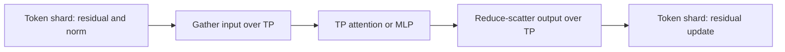

# Parallel training

Parallelism helps you process more independent samples or fit one sample's model computation
across several GPUs. Flow-Factory combines data parallelism (DP), tensor parallelism (TP),
sequence parallelism (SP) and context parallelism (CP).

For a runnable entry point, use the [4/4/8-GPU quickstart](quickstart.md).
Start with the concepts below, then [configure a layout](configuration.md), check your
[model](models.md) and [algorithm](algorithms.md), and compare [costs and benefits](performance.md).

## What each strategy divides

| Strategy | Work divided across peers | Main resource it can save | Work that stays shared |
|---|---|---|---|
| DDP | Different samples | Time to process a global batch | Each rank holds the model and optimizer; gradients synchronize |
| ZeRO-2 | Different samples; optimizer state and gradients are partitioned | Optimizer and gradient memory | Model weights remain replicated |
| FSDP2 | Different samples; parameters, gradients and optimizer state are sharded | Persistent training state | Needed weights are gathered for computation |
| TP | Matrix contractions within one model | Weight residency and selected matrix work per rank | Peers process the same sample and exchange activations |
| SP | Selected token activations over the **same TP group** | Residual, normalization and modulation activation memory | Attention and MLP inputs are gathered where required |
| CP | One sample's context over a separate group | Long-context attention and sequence activation memory | Attention exchanges context; the adapter restores complete predictions |

DDP, FSDP2 and ZeRO-2 are data-parallel training choices. The current TP/CP training composition
uses FSDP2. SP is an option on TP: it does not add a GPU dimension or create independent samples.

## How TP and SP cooperate

An MLP can distribute its expansion and contraction weights across TP peers. Its output residual
would ordinarily be replicated over those peers. SP instead retains token slices between matrix
operations, so normalization, modulation and residual updates can work on fewer rows.



Each model defines where this pattern is valid. An image stream, a text stream and a cached
prefix can have different token orderings and different gradient ownership. A TP-sharded weight
therefore does not imply that its input or output should also be token-sharded. Conversely, a
replicated weight can compute on SP tokens when its partial parameter gradients are summed.

**Parameter coverage and activation coverage answer different questions.** The
[model guide](models.md) lists both. Full model predictions are reconstructed before the
scheduler and training objective use them.

## Adding CP

CP is an independent axis. With TP2 × CP2, four ranks work on one logical sample. CP assigns
context partitions; TP divides matrix work within each partition; SP can further divide eligible
residual tokens over those same TP peers. Attention still sees the required full context.

All 19 registered model adapters currently declare **Ulysses** CP, using the native attention
backend. Ulysses exchanges sequence and head layouts. The shared runtime also has transport
machinery for Ring, but no current registered model declares Ring training support. Model-specific
masks, positions, caches and padding remain part of the [admitted layout](models.md).

## Eight GPUs, two logical data replicas

The process count is:

```text
world = DP × CP × TP
DP = dp_replicate_size × dp_shard_size
```

For DP2 × CP2 × TP2, the canonical rank order is `(dp_replicate, dp_shard, cp, tp)`:

| Logical data replica | CP coordinate | TP peers | Input ownership |
|---|---:|---|---|
| 0 | 0 | 0, 1 | Sample batch A, first context partition |
| 0 | 1 | 2, 3 | Sample batch A, second context partition |
| 1 | 0 | 4, 5 | Sample batch B, first context partition |
| 1 | 1 | 6, 7 | Sample batch B, second context partition |

Rank 3 communicates with rank 2 for TP, rank 1 for CP and rank 7 for logical-DP statistics.
Ranks 0–3 agree on sample identity, conditions, noise and timestep. Counting them as four samples
would overcount the batch. FSDP may shard training state over the joint DP-shard/CP dimension;
that does not change logical sample ownership.

Use [configuration and compatibility](configuration.md) to turn this geometry into a run.
