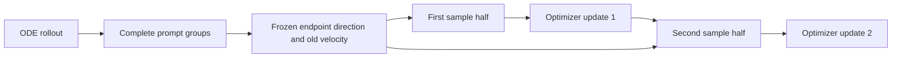

# DiffusionART

DiffusionART (`train.trainer_type: art`) learns from group rewards without differentiating the
reward model or evaluating transition log probabilities. It reuses Flow-Factory's acquisition,
reward reduction, replay and optimizer machinery. Differentiable reward algorithms are separate work.

## Default acquisition cycle

1. Generate K Euler ODE trajectories per prompt. Save the selected states, terminal endpoints and
   **actual rollout velocities**, before any optimizer update.
2. Wait for the full reward groups. Existing source/group/member identities determine membership;
   equal prompt strings do not merge different planned groups.
3. Compute one centered endpoint/reward covariance for each group and normalize its direction
   over active latent coordinates. The framework's configured advantage reducer provides scalar scores.
   Constant scores and zero covariance produce zero guidance. Joint audio/video uses one
   direction and trust mask per component, its own sigma/delta, and equal component-mean loss
   weights (matching the upstream AV objective). Frozen coordinates contribute zero.
4. Preserve packed-forward composition while ordering samples, then split the acquisition into
   two equal optimizer windows. Each sample appears in exactly one window. Both windows use the
   same frozen guidance and rollout anchor.
5. Update on the first window, recompute current predictions on the second window and update
   again. The second pass can correct movement caused by the first. This is the default recipe;
   update counts and replay epochs remain configurable.



The diagram describes `gradient_step_per_epoch: 2` and `num_inner_epochs: 1`, not an
algorithm admission rule. Other update counts use the shared accumulation schedule;
multiple inner epochs replay the acquisition with the same saved anchors and group guidance.

The model predicts `dx/dsigma`, with sigma decreasing during generation. Thus the regression target
is `old_velocity - art_guidance_scale * direction`, and the loss is sigma-weighted mean squared
error. A virtual Flow-SDE reference metric measures movement from the old velocity: it supplies
the trust-region mask but adds no noise to the actual ODE rollout. Large movements are masked
only when the current descent direction continues outward; corrective movements remain active.
Inactive/frozen latent coordinates do not contribute to direction normalization or loss.
H3 stores data-ward velocity: ART converts both current velocity and saved anchor to
`dx/dsigma` before this calculation; its native target is therefore `old + guidance`.

The implementation uses a bounded scalar-reward recipe from the
[pinned author code](https://github.com/vanzll/DiffusionART/tree/a676204fb48fd4711c8903a8e63573c22998bb96),
with the framework's velocity convention, sampler identities and reward reducer. It does not
claim all optional upstream covariance/mask variants or reproduction of pretrained quality scores.

## Configure ART

Start from the [official SD3.5/PickScore recipe](../../examples/art/lora/sd3_5/pickscore_8gpu.yaml).
Set the dataset location and, if using a local checkpoint, `model.model_name_or_path`.
The [recipe instructions below](#official-pickscore-recipe-8-gpus) describe the data and launch command.

| ART setting | Recipe value | Meaning |
|---|---|---|
| `train.trainer_type` | `art` | Select the ART trainer |
| `data.sampler_type` | `rank_local` | Keep complete prompt groups on each logical DP replica |
| `train.art_guidance_scale` | `1.0` | Scale the endpoint/reward direction in the target |
| `train.art_kl_threshold` | `1.0e-5` | Trust-region threshold for the virtual reference metric |
| `train.art_reference_noise_level` | `0.8` | Noise scale of that metric; generation remains ODE |
| `scheduler.replay_steps` | `all` | Replay every recorded ODE transition |

ART uses the shared [rollout replay selection](sampling.md), with `auto` selecting all ODE
transitions. It requires nonempty replay data and retains the final latent for group guidance.

Let D be logical DP size, U unique prompts per acquisition, K group size, B local batch size,
S selected steps and G `gradient_step_per_epoch`. The shared sampler geometry aligns U so each
replica has `U*K/(D*B)` rollout batches. With automatic accumulation, each update accumulates
`U*K*S/(G*D*B)` backward calls. `num_inner_epochs: E` repeats the acquisition E times, giving
G*E updates when accumulation divides the aligned geometry. TP/CP peers do not multiply D.

Explicit `gradient_accumulation_steps` takes precedence over G, exactly as in the other trainers.
ART adds no fixed update count or single-epoch restriction. `advantage_aggregation` and
`global_std` are handled by the shared feedback machinery, including supported custom reducers.
FP32 trajectory storage is the default; other framework-supported storage dtypes are permitted.

A prompt group may span multiple local microbatches; B need not equal K. Rank-local placement
keeps the complete endpoint/reward group available for covariance calculation.

## Support boundary

- Image/video and structured audio/video trajectories with `FlowMatchEulerDiscreteSDEScheduler`
  or `MiniMaxH3SDEScheduler` in ODE mode. Joint components share scalar reward guidance but retain independent latent
  directions, masks and timesteps. Modality-specific reward routing is a separate extension.
- Full or LoRA policy tuning through the existing backend. TP/SP are model-owned; CP uses the
  shared full-output loss normalization and the model's admitted layout.
- Selected rollout positions are unique, in range and replayed in the requested order. Shared accelerators preserve the
  usual parity contract; rollout-only accelerators are rejected.
- FP32 trajectory/callback storage is recommended to preserve the sampled anchor. Native compute precision and
  autocast remain model-owned; ART does not force RMSNorm or attention into a new precision mode.
- Asynchronous scoring and rank-local `ordered` / `ready` reward/optimization overlap use the
  existing tile stream. Set `shuffle_samples: false` and configure asynchronous CPU rewards as
  required by the shared overlap contract, including `num_inner_epochs: 1` and `global_std: false`.
  Each tile contains complete groups; accumulation spans tiles and follows the configured
  update schedule. Saved rollout velocities remain
  the anchor even when a later tile becomes ready after the first update. Ready order may change
  which samples enter the first window; use ordered scheduling for direct ordered comparisons.
- Checkpoint continuation uses the existing drained acquisition boundary, with ART settings in
  runtime identity. There is no new persistent target copy or in-flight graph checkpoint.

## Validation

The CPU controls independently check covariance, direction sign, target detachment, constant
signals, active masks, initial/interior reference metrics and corrective/outward masking. Registry,
argument and complete-group checks exercise the production entry points.

The selected native-model tests combine dimensions:

| Case | Purpose |
|---|---|
| FLUX.1 LoRA, DDP2 | Default and 3-update / 2-inner-epoch schedules, real image-derived rewards, frozen replay anchors, clipping/Adam reference and fresh-process continuation |
| Native LTX2/H3 AV, DDP2 | Per-component masks/times/sign, two cycles, genuinely pending reward futures, ordered/ready streaming and independent optimizer controls |
| Wan full, DP2×TP2 versus DP2×TP2×CP2 | Native video trajectories and frozen anchors; first-cycle elementwise gradient/update comparison, then all four updates with a separate common-parameter derivative control |

Checkpoint-loaded state is compared bitwise. The non-default multi-inner-epoch FLUX test
checks subsequent floating-point state at `rtol=1e-6, atol=1e-9` because a fresh DDP process
may change reduction ordering; counters/RNG remain exact and each run has an independent
clipping/Adam reference. Default fixed-topology continuation remains a bitwise check.

These tests use tiny native model structures and target integration correctness. They do not
measure pretrained convergence, reward quality or universal throughput. Run details and final
source identities belong in the PR's selected validation receipts.

The default trust mask is a discrete decision. BF16 reduction roundoff can place an observation
on opposite sides of its threshold after several updates. The Wan test retains uninterrupted
runs in both layouts, and separately resets weights to the reference trajectory to compare all
four local derivatives under unchanged tolerances. That intervention does not claim equality of
uninterrupted trajectories or remove the production mask. Same-layout fresh replay and FLUX
fixed-topology continuation remain exact assertions.

## Official PickScore recipe (8 GPUs)

The [8-GPU recipe](../../examples/art/lora/sd3_5/pickscore_8gpu.yaml) maps the author's
[pinned paper candidate](https://github.com/vanzll/DiffusionART/blob/a676204fb48fd4711c8903a8e63573c22998bb96/configs/paper/image/sd3_pickscore_art.yaml).
The upstream recipe itself does not certify historical curve reproduction.

| Setting | Value |
|---|---|
| Model / reward | SD3.5 Medium / existing PickScore loader |
| Adaptation | Attention LoRA rank 32, alpha 64, eight explicit projection targets |
| Rollout | 512×512, CFG 1, 10 Euler ODE steps, scheduler shift 3 |
| Group geometry | 64 prompts × 18 members / 8 DP ranks; batch 9; 16 batches/rank |
| Optimization | Two disjoint updates, all 10 steps; accumulation 80; AdamW 3e-4, decay 1e-4, clip 1 |
| Precision | FP32 policy/VAE storage and optimizer; FP16 text encoders and policy autocast; FP32 trajectory anchors |
| Budget | 500 acquisitions = 1,000 updates when none are overflow-skipped |
| Evaluation | Full 2,048-prompt test split, seed 42, 40 ODE steps, initially and every 25 acquisitions |
| Checkpoint | Full state every 100 acquisitions and at completion |

Prepare `train.jsonl` and `test.jsonl` in `dataset/art_pickscore`, or set
`data.datasets[0].dataset_dir` to their directory. Each line is a JSON object with a `prompt`
field, as described in the [dataset guide](datasets.md). For the official recipe, use the
[author's prompt dataset](https://huggingface.co/datasets/vanzl/DiffusionART-Prompts/tree/9d947fb510d67a8e5334ec1d8c7d8927f7658c08):
25,432 training prompts and 2,048 test prompts, without truncating either split.

From the repository root, with access to the base-model license and TensorBoard installed:

```bash
TORCH_ALLOW_TF32_CUBLAS_OVERRIDE=1 ff-train examples/art/lora/sd3_5/pickscore_8gpu.yaml
```

The configuration uses the public SD3.5 model ID and the standard multi-GPU Accelerate config.
Its explicit `mixed_precision: fp16` and `num_processes: 8` override the launcher defaults.
It reuses the existing SD3 adapter and PickScore loader. The upstream candidate uses a 128-token
text limit; the existing adapter retains its native pipeline default of 256.
TensorBoard logs live under the configured save directory; multiply normalized PickScore by 26
when comparing with raw-score plots. Record the model revision, library versions and seeds for
comparisons; experiment-specific observations and source snapshots belong in the PR evidence.

This run uses the framework's acquisition counter: 500 cycles do not certify 1,000 successful
updates if FP16 overflow skips a step. Review the update/overflow logs. The final checkpoint is
saved automatically; the final 1,000-update evaluation must be run separately because generation
periodic evaluation occurs before an acquisition. Retain the initial evaluation and compare the
same held-out prompts/seeds; rising training reward alone is not reproduction evidence.
